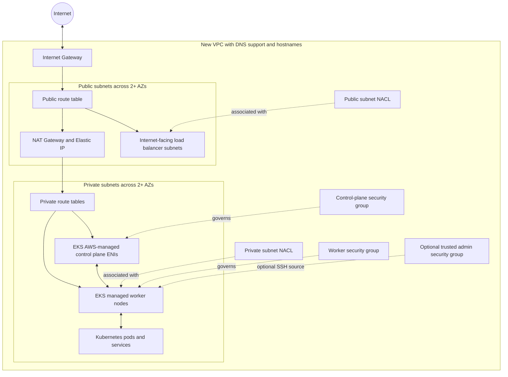

# terraform-module

## Modular EKS on a new VPC

This project describes a multi-AZ VPC and an AWS-managed Amazon EKS control plane with a private managed node group. It does not create a self-managed EC2 control-plane instance. The default worker count is two and worker nodes are placed only in private subnets.

## Architecture



Public subnets carry the EKS load-balancer discovery tag; private subnets carry the internal load-balancer discovery tag. Both subnet tiers are tagged for this cluster. Route tables provide public internet routing through the IGW and optional private outbound routing through NAT. The private NACL permits internal VPC communications and ephemeral return traffic because NACLs are stateless.

## Project structure

```text
eks-terraform/
├── main.tf
├── backend.tf
├── backend.hcl.example
├── providers.tf
├── variables.tf
├── outputs.tf
├── terraform.tfvars.example
├── versions.tf
├── README.md
├── eksctl-cluster.yaml.example
├── environments/
│   ├── dev/                 # Dev variables and isolated S3 backend key examples
│   ├── test/                # Test variables and isolated S3 backend key examples
│   ├── staging/             # Staging variables and isolated S3 backend key examples
│   └── prod/                # Production variables and isolated S3 backend key examples
└── modules/
    ├── vpc/                 # VPC and DNS settings
    ├── subnets/             # Public/private subnets and EKS discovery tags
    ├── internet-gateway/    # IGW attachment
    ├── nat-gateway/         # Optional NAT Gateway(s) and Elastic IP(s)
    ├── route-tables/        # Public/private routes and subnet associations
    ├── nacl/                # Configurable stateless public/private ACLs
    ├── security-groups/     # Control plane, worker, and optional admin groups
    ├── iam/                 # EKS, node, and optional CSI Pod Identity roles
    ├── eks-cluster/         # AWS-managed EKS control plane
    ├── eks-nodegroup/       # Managed node group and custom-SG launch template
    └── eks-addons/          # VPC CNI, CoreDNS, kube-proxy, optional CSI
```

Every Terraform module has `main.tf`, `variables.tf`, and `outputs.tf`. Root outputs expose the VPC/subnet IDs, EKS name/ARN/endpoint/CA data, and node group name.

## Environments

The `environments/dev`, `environments/test`, `environments/staging`, and `environments/prod` directories are configuration sets, not duplicated Terraform module code. All environments use the same root configuration and reusable modules. Each set includes a `terraform.tfvars.example` and a `backend.hcl.example`; copy these to ignored local files named `terraform.tfvars` and `backend.hcl` in that environment directory, then edit the values. Each backend example has a distinct S3 key so environments cannot accidentally share the same state object. Use the same pre-created state bucket only if its access controls and organizational policy allow it.

Run Terraform commands from the project root and explicitly select the matching files. For example, after completing the dev files:

```sh
terraform init -backend-config=environments/dev/backend.hcl
terraform validate
terraform plan -var-file=environments/dev/terraform.tfvars
```

Select `test`, `staging`, or `prod` in both paths to work with that environment. The backend is initialized separately from ordinary input variables. When changing the selected backend, reinitialize intentionally with the matching backend config (and `-reconfigure` when switching an already initialized working directory); always verify the backend key and variable file before any plan or apply. Prefer separate workspaces/directories or CI jobs per environment to reduce accidental environment switching. Example sizing is illustrative, not a production capacity recommendation.

## Module relationships

The root module builds VPC -> subnets -> gateways/routes/NACLs/security groups/IAM -> EKS control plane -> managed node group and add-ons. IDs and ARNs flow through module outputs. Root-level dependencies wait for IAM policies and the control plane before creating workers and add-ons. A launch template attaches the dedicated worker security group to the managed node group; optional SSH adds the admin group only when both a key pair and trusted SSH CIDRs are set.

The EKS control plane is AWS-managed. Its ENIs use private subnet IDs and the additional control-plane security group. The endpoint defaults to private-only. Public API access, when selected, requires a non-empty trusted CIDR list. Private endpoint clients can be separately allowed with `eks_admin_access_cidrs`.

## Inputs to set

Copy `terraform.tfvars.example` to a private local `.tfvars` file and provide values for:

| Input | Requirement / default |
| --- | --- |
| `aws_region` | Required; select the deployment region. |
| `aws_profile` | Optional; omit to use the AWS credential chain. Never put credentials in tfvars. |
| `kubernetes_version` | Required; choose a currently supported EKS version in the selected region. |
| `availability_zones` | Required; use at least two distinct AZs in that region. |
| `worker_instance_type` | Required; select the worker size later. No instance type is assumed by Terraform. |
| `vpc_cidr`, public/private subnet CIDRs | Defaults shown; adjust to avoid overlap with connected networks. One subnet per AZ in each tier. |
| `desired_worker_count`, `minimum_worker_count`, `maximum_worker_count` | Defaults 2, 1, and 4. Desired must remain within min/max. |
| `worker_disk_size`, `worker_ami_type`, `node_group_name` | Defaults 50 GiB, AL2023 x86_64, and `private-workers`. |
| `eks_endpoint_access` | Defaults `private`; accepted values are `private`, `public`, or `both`. |
| `eks_public_access_cidrs` | Required and narrowly scoped if public endpoint access is enabled. Never default to `0.0.0.0/0`. |
| `eks_admin_access_cidrs` | Optional trusted source CIDRs for private endpoint administration. |
| `nat_gateway_enabled`, `single_nat_gateway` | Defaults enabled and single NAT. Per-AZ NAT costs more and improves AZ-level egress isolation. |
| `ssh_key_pair_name`, `ssh_trusted_cidrs` | Optional; both must be configured for SSH. Prefer SSM Session Manager. |
| `control_plane_log_types`, `enable_ebs_csi_driver`, `resource_tags` | Defaults enable all five EKS control-plane logs, EBS CSI, and project tags. |
| `public_nacl_*_rules`, `private_nacl_*_rules` | Optional full rule-list overrides. Rules are stateless; include request and return traffic in both directions. |

The example's Kubernetes version and region/AZ values are examples, not guarantees that the version/AZ pair is currently available in your account. Verify them before deployment. The worker instance type is intentionally left unset so Terraform prompts for it until you add your selected value.

## Remote Terraform state (S3)

The root backend is configured for Amazon S3 with server-side encryption enabled and native S3 lockfiles (`use_lockfile = true`). The state object is stored at the configurable S3 key, whose example ends in `terraform.tfstate`. Terraform creates a separate `.tflock` object at that key while holding the state lock and removes it after releasing the lock.

The S3 bucket must already exist before Terraform backend initialization. This project intentionally does not create or modify the state bucket. Create it separately with suitable security controls, block public access, restrict bucket access to the Terraform operators/role, and enable S3 bucket versioning so prior state object versions can be recovered after accidental overwrite or deletion. Bucket versioning is recommended operational setup and is not enabled by this EKS deployment. Native S3 lockfiles require Terraform 1.10 or newer; the project version constraint reflects that requirement. Grant the backend identity the S3 permissions needed to list the bucket and get/put the state object, plus get/put/delete the corresponding `.tflock` object. No credentials are embedded in the configuration.

Set bucket name, state key, and backend AWS region in a local `backend.hcl` based on `backend.hcl.example`. The backend region is independent of the AWS provider's `aws_region`. The local `backend.hcl` is gitignored. Supply credentials through the AWS standard credential chain (for example, an IAM role or a local AWS profile); do not put credentials in `backend.hcl` or project files. The optional `aws_profile` provider setting does not configure credentials for Terraform's S3 backend; select the profile through the normal AWS environment/profile mechanism when initializing.

`.terraform.lock.hcl` is Terraform's provider dependency lock file: it records selected provider versions and checksums and should be committed to Git once generated by a later initialization. It is not Terraform state and must not be uploaded as the remote state object. The remote state remains the S3 object ending in `terraform.tfstate`; S3's separate `.tflock` object handles state locking.

## Network and security notes

- Public subnets are for load balancers and NAT gateways; managed workers and EKS control-plane ENIs use private subnets.
- A single NAT gateway is the cost-conscious default and creates a cross-AZ dependency for some private subnet egress. Set `single_nat_gateway = false` for one NAT gateway per public subnet/AZ.
- Disabling NAT removes the private default route. Nodes then need appropriate VPC endpoints or another egress path to reach image registries and AWS APIs.
- The default public NACL allows HTTP, HTTPS, and ephemeral inbound traffic; the private NACL allows VPC-internal traffic and ephemeral response traffic. Default outbound NACL rules are intentionally broad to avoid breaking EKS, Kubernetes, and NAT return flows. NACLs are stateless, and custom rules must preserve return traffic.
- Security groups allow worker-to-worker traffic, worker-to-control-plane HTTPS, and required control-plane callbacks. Egress is explicitly enabled; restrict it only after accounting for cluster, image, logging, and AWS API endpoints.
- Public endpoint CIDRs constrain the endpoint itself as well as a matching security-group rule. Do not use broad trusted CIDRs. For a private-only API, configure a reachable VPN/bastion/administration network and `eks_admin_access_cidrs`.
- The node role includes the AWS-managed worker, ECR pull-only, and VPC CNI policies. For a stricter production posture, move VPC CNI permissions from the node role to a dedicated workload identity role after validating the add-on setup.
- The CSI role trusts EKS Pod Identity and is associated only with the EBS CSI controller service account. The module installs the Pod Identity agent when CSI is enabled.
- `eksctl` and Terraform are alternative owners of an EKS cluster. Do not run the `eksctl` example against the same cluster managed by `module.eks_cluster`, and do not use both creation paths together. Terraform root configuration is the complete Terraform-managed path; the separate eksctl template is provided for an eksctl-owned path using existing network IDs.

## Later deployment

No initialization, plan, apply, AWS CLI, or cluster creation has been run as part of generating this project. After reviewing the configuration, choosing inputs, and deciding whether Terraform or eksctl owns the cluster, the Terraform-managed path would be:

```sh
cd eks-terraform
cp environments/dev/terraform.tfvars.example environments/dev/terraform.tfvars
cp environments/dev/backend.hcl.example environments/dev/backend.hcl
# Edit the dev files; set worker_instance_type, supported Kubernetes version,
# and the existing state bucket name/region. The example backend key is already dev-specific.
terraform init -backend-config=environments/dev/backend.hcl
terraform validate
terraform plan -var-file=environments/dev/terraform.tfvars
terraform apply
```

The eksctl-owned alternative requires network/subnet IDs and a worker instance type in `eksctl-cluster.yaml`; use it instead of creating this same cluster through Terraform. Once you have filled the placeholders and reviewed eksctl's current add-on/IAM requirements, the cluster creation command is `eksctl create cluster -f eksctl-cluster.yaml`. No command is executed by this README.

## Assumptions and limitations

- IPv4 networking is used; IPv6 CIDRs and IPv6 NACL/security-group rules are not included.
- NAT gateways, public IPv4 addresses, EKS, worker EC2 instances, and CloudWatch log ingestion incur AWS charges. This project does not configure budgets or log retention.
- The example uses no SSH by default and no broad EKS API access. IAM policies are AWS-managed policies; audit their current scope before production use.
- EKS add-on versions are selected as the newest version compatible with the cluster unless an explicit version is supplied to the `eks-addons` module.
- The root module assumes exclusive ownership of these resource names/IDs and a new VPC; it does not import or modify pre-existing infrastructure.
